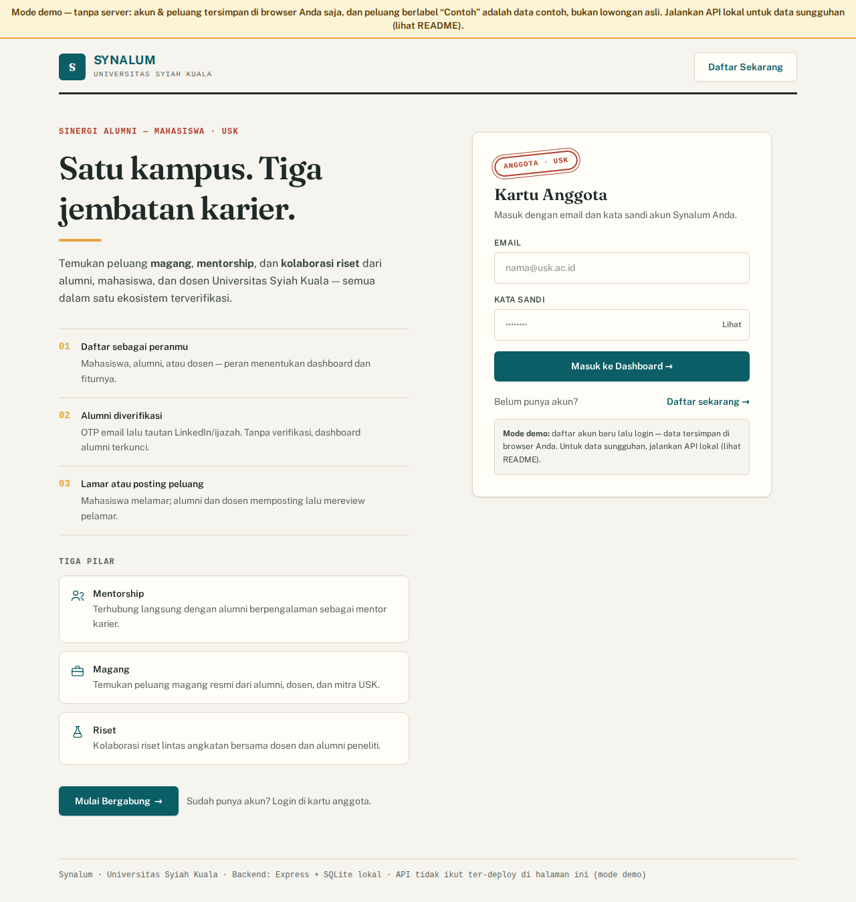
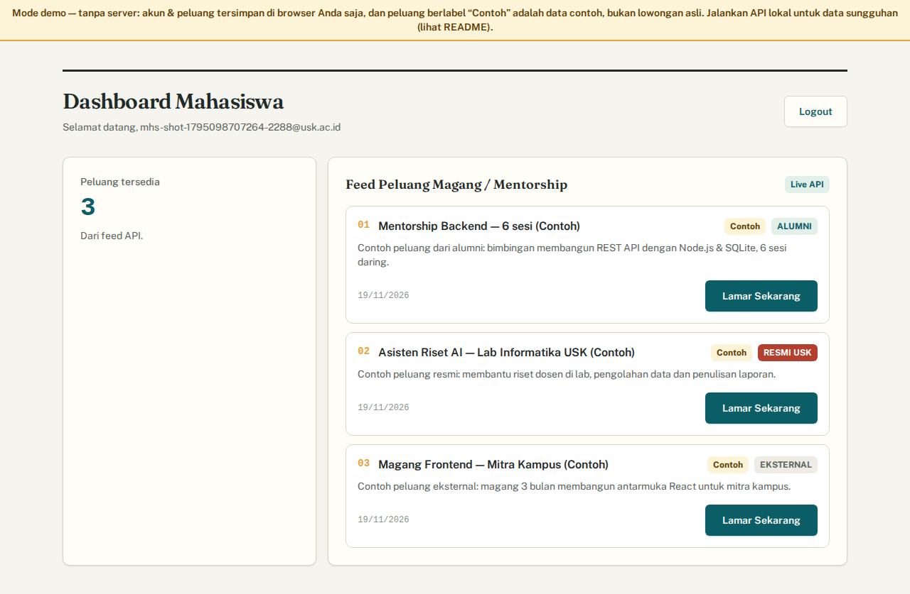
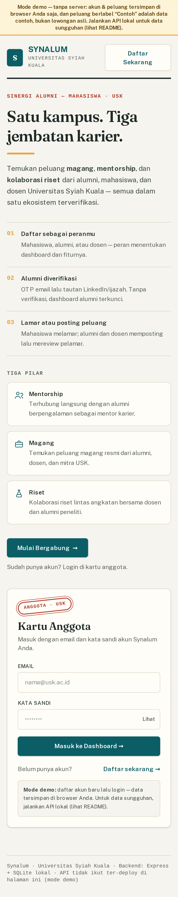
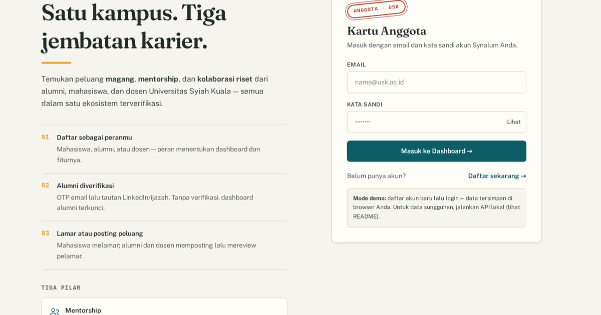

# SYNALUM — Synergy Alumni & Mahasiswa

Platform kolaborasi karier **Universitas Syiah Kuala (USK)**: alumni
memposting peluang magang, mentorship, dan riset; mahasiswa melamar;
dosen membuka riset resmi lalu mereview pelamar — semua dalam satu
papan pengumuman yang terverifikasi.

**Live (client, mode demo): https://synalum.pages.dev/** — tanpa server:
daftar, login, verifikasi OTP demo, posting peluang, dan lamaran bisa
dicoba langsung di browser. Data demo tersimpan di browser Anda saja,
peluang bawaan berlabel "Contoh".

> **Jujur soal backend:** API Express + SQLite **belum di-deploy**
> (Pages hanya menyajikan file statis). Menunggu keputusan deploy
> backend (Docker + Coolify) — lihat `docs/DEPLOY.md`. Jangan klaim API
> "hosted" di mana pun.

## Tampilan

> Screenshot dan video demo di bawah ini diambil dari artifact CI
> Playwright (build demo yang sama dengan yang live), bukan mockup.







**Video demo** — tur singkat: daftar sebagai mahasiswa → feed peluang →
lamar → login ulang (direkam Playwright di CI, 1280×800):

[](docs/screenshots/demo.mp4)

## Peran & fitur

| Peran | Fitur |
|---|---|
| Mahasiswa | Daftar, login, feed peluang, melamar (1x per peluang) |
| Alumni | Verifikasi 2 lapis (OTP + LinkedIn/ijazah), posting peluang (badge ALUMNI_POST), review pelamar, terima/tolak lamaran |
| Dosen / Admin | Seperti alumni; postingannya ber-badge RESMI_USK |

Yang **bukan** fitur (jangan dikira ada): pengiriman email sungguhan,
moderasi dokumen oleh admin, pencocokan mentor, chat, notifikasi, dan
upload file. Detail + keterbatasan: `docs/PRD.md`.

## Cara jalanin (lokal, data sungguhan)

```bash
# 1. API (port 5000, SQLite lokal — tanpa cloud)
cd synalum-api
cp .env.example .env   # isi JWT_SECRET
npm install
npm start              # atau: npm run dev (nodemon)

# 2. Client (port 5173, proxy /api → :5000)
cd ../synalum-client
npm install
npm run dev
```

Buka http://localhost:5173 — daftar akun baru (pilih peran), lalu login.
Alumni diarahkan ke verifikasi: minta OTP (mode demo menampilkan
kodenya di layar), verifikasi, kirim tautan LinkedIn/ijazah, lalu
dashboard alumni terbuka.

## Tech stack

| Layer | Teknologi |
|---|---|
| Frontend | React 19 + Vite 8 + Tailwind CSS v4 |
| Backend | Express 5 (Node.js) |
| Database | SQLite via `better-sqlite3` (file lokal, tanpa kredensial) |
| Auth | JWT + bcryptjs |
| HTTP | Axios (frontend) |
| Dev | concurrently, nodemon |

> Database adalah file `synalum-api/synalum.db` yang dibuat otomatis
> saat pertama jalan. File `synalum.db-shm` / `.db-wal` sempat
> ter-commit sebelum audit 19 Nov 2026 — sudah dihapus dari tree.

## Struktur

```text
synalum/
├── package.json            ← Root — one-click dev runner (concurrently)
├── README.md
├── LICENSE                 ← MIT
├── .github/workflows/ci.yml
├── scripts/                ← advisory-sweep.py, check-p0.mjs, make-og-image.py
├── docs/                   ← PRD, ARCHITECTURE, API, TESTING, DEPLOY, DESIGN, diagrams.html
├── Synalum-showcase/       ← Landing preview statis (arsip, bukan aplikasi)
├── synalum-api/            ← Express REST API (port 5000)
│   ├── server.js  db.js  jwtSecret.js
│   ├── controllers/  routes/  middlewares/
│   └── test/api.test.js    ← 9 tes end-to-end (node:test)
└── synalum-client/         ← React/Vite frontend (port 5173)
    ├── src/pages/          ← LandingPage, RegisterRole, AlumniVerification
    ├── src/pages/dashboard/← Student, Alumni, Lecturer
    ├── src/utils/demoApi.js← Mock API mode demo (hanya bila VITE_DEMO_MODE=true)
    └── e2e/                ← Playwright: desktop + Pixel 7, video tur
```

## API

Ringkas: `POST /api/auth/register`, `POST /api/auth/login`,
`GET /api/opportunities/all`, `POST /api/opportunities/create`,
`POST /api/applications/apply`,
`GET /api/applications/:id/applicants`,
`PUT /api/applications/:id/status`,
`POST /api/verify/request-otp`, `POST /api/verify/confirm-otp`,
`POST /api/verify/submit-docs`, `GET /api/health`.
Lengkap + contoh curl: `docs/API.md`.

## Tes

```bash
cd synalum-api && npm test            # 9 tes API end-to-end
cd ../synalum-client && npm run lint  # ESLint
node scripts/check-p0.mjs             # gate anti-slop P0 (dari root repo)
python3 scripts/advisory-sweep.py     # OSV, 3 lockfile, produksi saja
```

E2E Playwright hanya di CI (Chromium tidak bisa jalan di VM dev):
lihat `docs/TESTING.md` dan job `playwright-e2e` di
`.github/workflows/ci.yml`.

## Desain

Arah desain dikunci di `docs/DESIGN.md` ("Buku besar kampus": Kertas +
Tinta + Teal USK + Kunyit + Merah Cap; Fraunces + Public Sans; cap
verifikasi bundar + nomor baris mono). Referensi: UNISR alumni platform
(<https://dariozanna.com/work/unisr/>), UC Davis GSM Alumni Platform
(<https://www.yingwliu.com/work/uc-davis-gsm>), EduSpace Alumni Module
(<https://sharafa.framer.website/projects/eduspace>).
